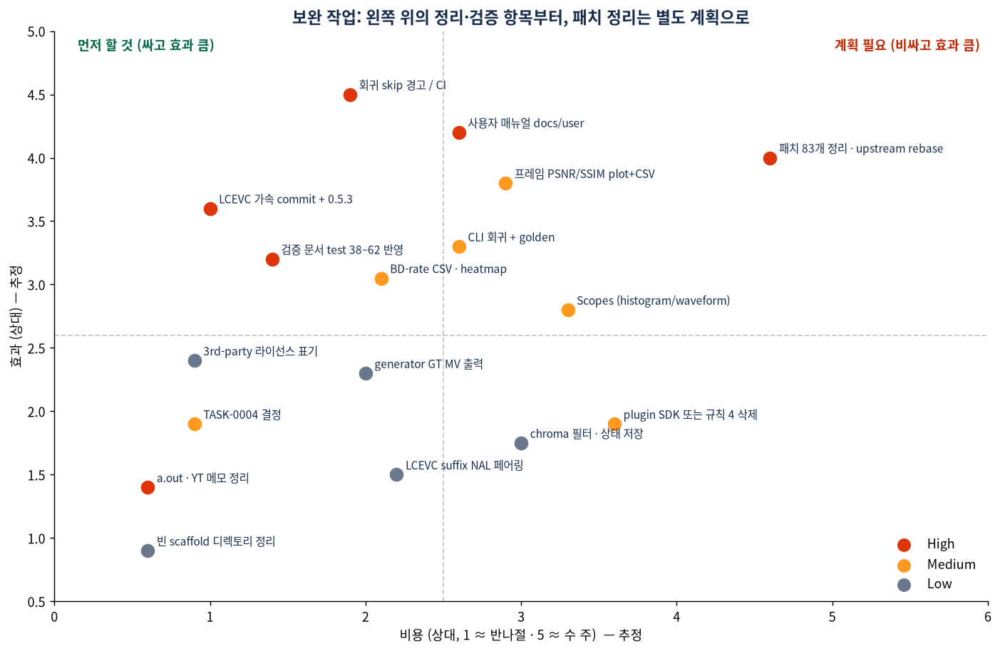
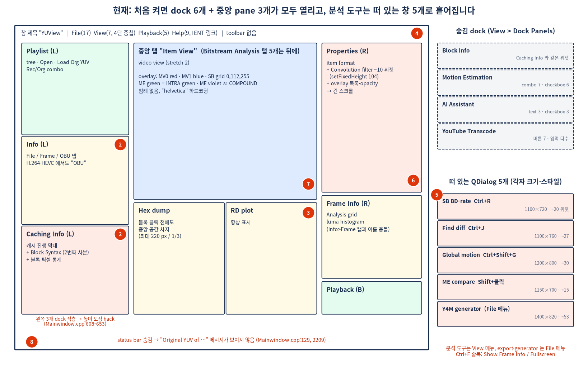
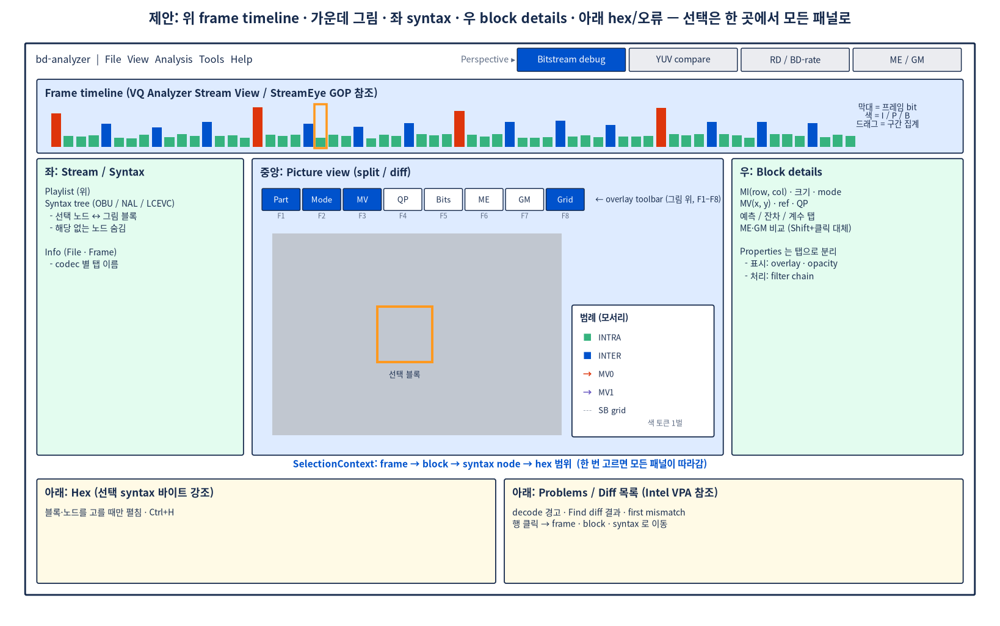
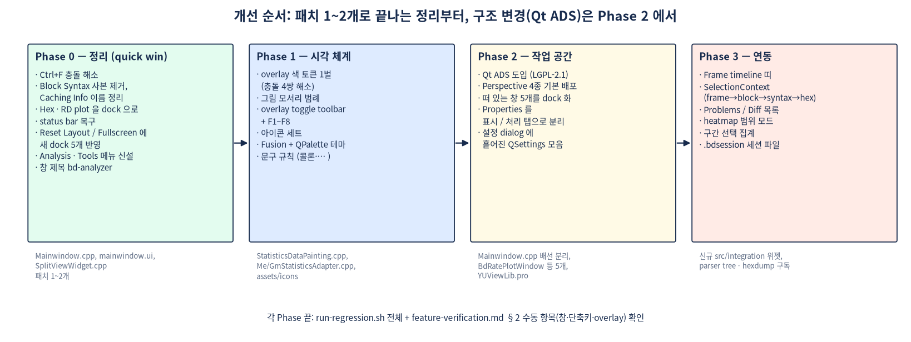

# 보완 작업 검토와 화면 구성 개선 제안

기준: `main` 9e4b169 (0.5.2) + 미커밋 LCEVC 작업, upstream `a72eb348` + 패치 0001–0083.
Confluence: IT 스페이스 "YUView (Linux-Rocky8.x)" 하위 "bd-analyzer 보완 작업 검토와 화면 구성 개선 제안 (2026-10-30)".
그림: `img/ui-review-*.png` (생성 `img/ui-review-diagrams.py`).

검증 상태: 패치 수 83, Ctrl+F 중복, `assets/icons`·`docs/user`·`src/app` 이 비어 있는 것은 직접 확인했다.
나머지 줄 번호는 조사 에이전트 보고 기반이며 미검증이다 (경로는 아래에 그대로 남겼다).
외부 도구의 UI 사실은 공급사 문서 기반이고, 독립 리뷰는 찾지 못했다.

## 1. 보완 필요 작업

### High
1. **LCEVC LTM 가속** (38.6 → 18.5 ms/frame) — 7a6f646 으로 커밋했다 (2026-10-31). 0.5.3 release·번들 갱신은 남았다.
   루트의 `a.out`, `YT_DOWNLOAD_SPEED_TASK.md` 는 Knight 의 개인 파일이라 정리 대상이 아니다.
2. **사용자 매뉴얼 없음** — `docs/user/` 는 `.gitkeep` 만. README:14 는 있다고 적고 있다.
3. **검증 문서가 낡음** — `docs/dev/feature-verification.md:33-59` 가 회귀 test 37 까지만, unit 22개 중 8개만 적는다.
   `docs/ai/README.md` 색인에 design 문서 9개가 빠져 있다.
4. **회귀가 조용히 skip** — `tests/run-regression.sh:158,366,403-407,509,593` 등. JM/HM/dav1d internals/libaom 이 없으면
   해당 테스트가 빠진 채 PASS. 끝에 skip 요약과 실패 옵션이 필요하다. CI 없음.
5. **패치 83개 / 17.6k 줄** (README:18 목표 <20). `Mainwindow.cpp` 를 28개 패치가 건드리고, upstream 트리 안에 새 파일 19개
   (설계 규칙 2 위반). upstream pin 6개월 경과.

### Medium
- 프레임 단위 PSNR/SSIM(VMAF) plot + CSV — `src/yuv/metrics/` 비어 있음, SSIM·VMAF 코드 0건.
- Scopes (frame histogram / waveform / vectorscope) — `src/yuv/scopes/` 비어 있음.
- SB BD-rate: GUI CSV export, heatmap, sweep 중 seek 처리 (`sb-bdrate-design.md:297-310, 377-385`).
- TASK-0004 (decoded YUV / 통계 캐시) 구현 또는 close 결정.
- CLI 도구 9개를 회귀에 넣고 `tests/golden/` 에 기준 출력.
- plugin SDK (`IFilter/IPattern/IMetric`) 가 없다 — 만들거나 README 규칙 4 를 지운다.

### Low
- stale 체크박스 (TASK-0001/0003/0009), DEFAULT_FRAMERATE 결정 대기.
- generator GT MV 출력, chroma 필터·필터 상태 저장, H.264 기본 디코더 설정 항목, LCEVC suffix NAL 페어링, DIS crop.
- 빈 scaffold 디렉토리 (`src/core/*`, `src/app`, `src/bitstream/{avc,hevc,common}`, `packaging/{appimage,flatpak,windows}`).
- README 라이선스 절에 번들 3rd-party (OpenCV, JM, HM, LTM, dav1d, FFmpeg) 표기.

## 2. 현재 화면 구성과 조잡함의 원인

경로 `U` = `third_party/yuview/upstream/YUViewLib` (패치 적용 상태), `I` = `src/integration`.

| # | 관측 | 근거 |
|---|---|---|
| 1 | 처음 켜면 dock 6개 + 중앙 pane 3개. 왼쪽 dock 3개 적층에 높이 보정 hack | `U/ui/mainwindow.ui:113-381`, `Mainwindow.cpp:608-653` |
| 2 | 같은 `BlockInfoWidget` 이 Block Info dock 과 "Caching Info" 안에 두 개. Info>Frame 탭 vs Frame Info dock. H.264/HEVC 에도 "OBU" 탭 | `Mainwindow.cpp:274-336`, `FileInfoWidget.cpp:128` |
| 3 | Hex dump·RD plot 이 블록 클릭 전에도 중앙 하단 차지 | `mainwindow.ui:77-87`, `Mainwindow.cpp:600-606` |
| 4 | 분석 도구는 View, export·generator 는 File. Tools 메뉴 없음. View 4단 중첩. **Ctrl+F 중복** | `Mainwindow.cpp:866` (Show Frame Info), `SplitViewWidget.cpp:2257` (Fullscreen) — 직접 확인 |
| 5 | 떠 있는 QDialog 5개 (1100–1400 px), 크기·스타일 제각각 | `I/BdRatePlotWindow.cpp:392`, `StreamDiffWindow.cpp:174`, `GlobalMotionWindow.cpp:60`, `MeCompareWindow.cpp:42`, `SequenceGeneratorWindow.cpp:323` |
| 6 | Properties dock 에 item format + filter chain + overlay 목록 | `videoHandlerYUV.cpp:4001-4068` |
| 7 | overlay 색 충돌 (MV1 blue ≈ SB grid, ME green = INTRA, ME violet ≈ COMPOUND, ME cyan ≈ GM), 범례 없음, "helvetica" | `SplitViewWidget.cpp:67-80`, `I/MeStatisticsAdapter.cpp:74`, `I/GmStatisticsAdapter.cpp:42` |
| 8 | toolbar 0, 아이콘 0, 하드코딩 색 약 10개 파일, status bar 숨김 | `Mainwindow.cpp:129`, `assets/icons/` |
| 9 | Reset Window Layout 이 새 dock 5개를 모르고, Fullscreen 이 3개 dock 을 안 숨김 | `Mainwindow.cpp:2291-2302, 1962-1970` |
| 10 | 창 제목 "YUView", 문구 규칙 혼재 (콜론, `…`/`...`, Stabilisation/Stabilized) | `Mainwindow.cpp:1796`, `playlistItemWithVideo.cpp:622` |

결론: 기능이 많아서라기보다 **기본 배치, 작업별 레이아웃, 패널 간 선택 연동, 시각 규칙이 없어서** 어수선하다.

## 3. 참조 외부 도구

| 도구 | 가져올 것 | 라이선스 |
|---|---|---|
| ViCueSoft VQ Analyzer | 위 Stream View (썸네일·프레임 크기 막대), 왼쪽 Syntax, F1–F12 mode 전환, NAL ↔ 블록 양방향 선택, 패널 detach | 상용 (사내 floating license 보유) |
| Elecard StreamEye | GOP 썸네일, 블록 overlay 종류, 다중 스트림 Compare/Subtraction/split, 창 Binding | 상용 |
| Intel VPA | 경고·오류 목록 → 클릭으로 위치 이동, 블록 Details View | 상용 (판매 상태 미검증) |
| AOM Analyzer | overlay 를 layer 로 쌓기, heatmap 범위 Frame/Video relative, URL 로 상태 공유 | 오픈소스 |
| RenderDoc | 선택한 event 를 모든 패널이 따라감, 안 쓰는 항목 숨김 | MIT |
| Perfetto | track pin, 구간 드래그 → 집계 | Apache-2.0 |
| Qt Advanced Docking System | perspective (이름 붙인 레이아웃), auto-hide, dark mode, Qt6 — Qt Creator 가 사용 | LGPL-2.1 |

출처: VQ Analyzer User Guide (cdn.vicuesoft.com/vqAnalyzer/docs/VQAnalyzerUserGuide.html), elecard.com/products/video-analysis/streameye,
intel.com VPA quality issues 문서, people.videolan.org/~negge/AOM_Analyzer_update_2021-Aug-13.pdf, renderdoc.org/docs,
perfetto.dev/docs/visualization/perfetto-ui, github.com/githubuser0xFFFF/Qt-Advanced-Docking-System.

## 4. 제안 레이아웃과 순서

- **Phase 0 (패치 1–2개)**: Ctrl+F 해소, Block Syntax 사본 제거·Caching Info 정리, Hex/RD plot 을 dock 으로, status bar 복구,
  Reset Layout/Fullscreen 에 새 dock 반영, Analysis·Tools 메뉴, 창 제목.
- **Phase 1**: overlay 색 토큰 1벌 + 범례 + overlay toggle toolbar (F1–F8), 아이콘, Fusion + QPalette 테마, 문구 규칙.
- **Phase 2**: Qt ADS + perspective 4종 (Bitstream debug / YUV compare / RD·BD-rate / ME·GM), 팝업 5개 dock 화,
  Properties 표시/처리 분리, 흩어진 QSettings 를 설정 dialog 로.
- **Phase 3**: frame timeline 띠, SelectionContext (frame → block → syntax → hex), Problems/Diff 목록, heatmap 범위 모드,
  구간 집계, `.bdsession`.

주의: Phase 2 의 Qt ADS 도입은 패치가 아니라 `src/integration` 쪽 새 의존성이다. 번들 크기·RPM 의존성·`Mainwindow.cpp`
충돌 패치 수를 먼저 따져야 한다. Phase 0–1 은 기존 패치 위에서 끝난다.

## 5. Phase 0 구현 (패치 0084, 2026-10-31)

Knight 지시: hex dump 는 지금 자리(그림 아래)를 유지하고 나머지는 진행.

| 항목 | 결과 |
|---|---|
| Ctrl+F 충돌 | Fullscreen 이 Ctrl+F 유지, Show Frame Info → Ctrl+Shift+F |
| 중복 Block Info | 숨김 `blockInfoDock` 삭제, `cachingInfoDock` 제목을 Block Info 로, Ctrl+B |
| RD plot | 중앙 하단 splitter 에서 `rateDistortionPlotDock` 으로 (아래, 기본 숨김, Ctrl+Shift+R). hex dump 는 그대로이고 가로 전체를 쓴다 |
| 메뉴 | Analysis (BD-rate, Find diff, Global motion), Tools (Y4M 생성, Filtered/Stabilized export). action 문구는 그대로 — 회귀 42/43/45/53 이 문구로 찾는다 |
| status bar | 다시 보임 (Fullscreen 에서는 숨김) |
| Reset Window Layout | 16진 상태 blob 대신 dock 10개를 코드로 배치 |
| Fullscreen | 보이던 dock 을 전부 숨기고 그대로 되살림 (`fullScreenHiddenDocks`) |
| 창 제목 | bd-analyzer |

- 검증: 회귀 `63-mainwindow-layout` 신설 (단축키 중복, BlockInfoWidget 1개, 메뉴 위치, Reset 후 배치, Fullscreen 왕복).
- 함께 고친 문서: `assets/assist/system-prompt.md` (AI Assistant 가 안내하는 패널·메뉴), `docs/dev/feature-verification.md` §2.1.
- 남은 것 (검토에서 나온 외형 문제): 첫 실행의 `resizeDocks` 가 창이 뜨기 전이라 폭이 안 먹을 수 있다. 숨김 dock(ME/AI/YouTube)을 켜면
  오른쪽 열에 세로로 쌓여 Properties 가 좁아진다 — 패치 전과 같은 동작. Phase 2 의 perspective 에서 다룬다.
